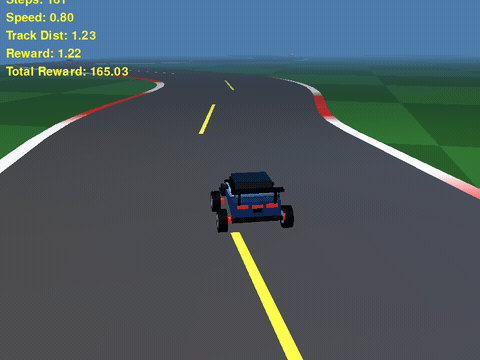
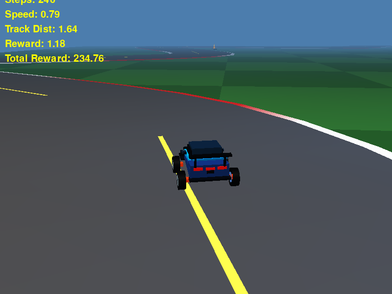
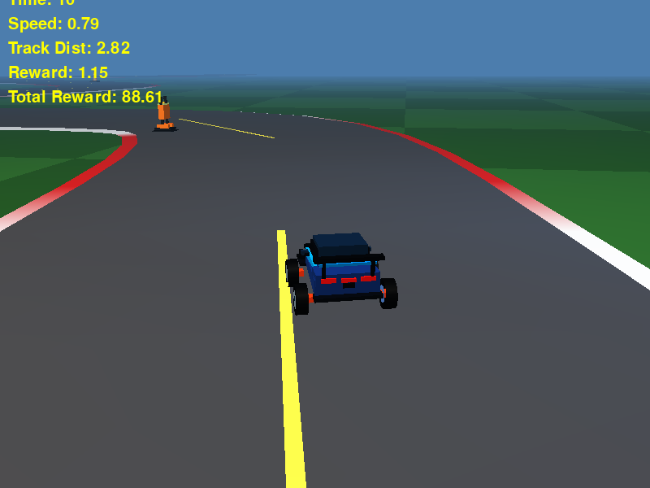
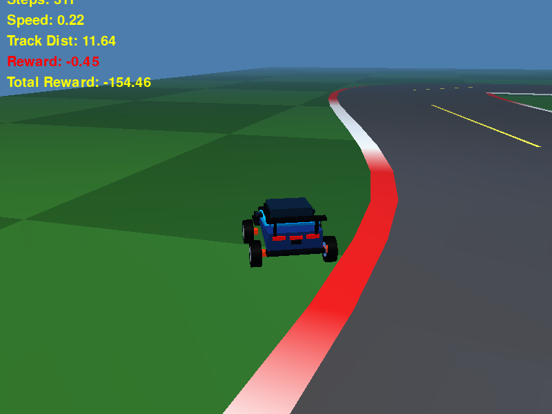
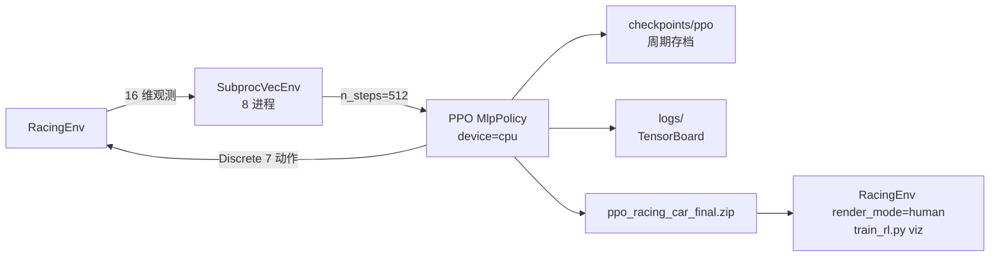

# 🏎️ RacingCar · 基于 PPO 强化学习的 3D 赛车自动驾驶


自研 3D 赛车环境（Pygame + PyOpenGL 固定管线渲染）＋ **Stable-Baselines3 PPO** 训练的自动驾驶智能体。
赛道每回合随机生成，车辆以 7 个离散动作控制，支持多核 CPU 并行采样、周期存档、断点续训与可视化评估。

<div align="center">



*仓库内置模型 `ppo_racing_car_final.zip` 的实际驾驶画面 —— `python train_rl.py viz ppo_racing_car_final`*

[▶ 观看完整 15 秒视频（MP4，800×600 / 60 FPS）](assets/video/ppo_racing_car_demo.mp4)

</div>

## ✨ 项目亮点

| 特性 | 说明 |
| --- | --- |
| 🎮 纯 OpenGL 手写 3D 场景 | 棋盘格草地、红白路肩、黄色虚线中心线、低多边形树木，日光 + 冷色补光与指数雾 |
| 🏁 程序化赛道 | Catmull-Rom 样条由 20 个极坐标控制点生成（半径 ~150、扰动 ±40），每回合路型都不同 |
| 🧠 16 维状态 / 7 动作 | 位置、朝向、速度、赛道偏差 + 9 条射线雷达探测障碍物 |
| ⚡ 多核并行采样 | `SubprocVecEnv` 8 进程并行，`device="cpu"` 下无需显卡即可训练 |
| 💾 断点友好 | 周期 checkpoint + `continue` 续训，不丢训练进度 |
| 👀 双模式 | `human` 渲染评估 / 无渲染高速训练，共用同一套 `RacingEnv` |

## 🎬 效果演示

| PPO 智能体（评估模式） | 手动模式（`main.py`） | 随机策略（Baseline） |
| :---: | :---: | :---: |
|  |  |  |
| Speed 0.79 / Track Dist 1.64，全速贴线过弯 | W/S 加减速、Q/E 转向，HUD 显示 Time / Reward | Track Dist 11.64，几乎冲出赛道，累计奖励 −154.46 |

### 实测表现

`ppo_racing_car_final.zip` 与随机策略在同一环境各跑 **20 个回合**（`model.predict(obs, deterministic=True)`，赛道每回合随机生成，单回合上限 `max_steps = 2000`）：

| 策略 | 平均奖励 | 平均步数 | 跑满 2000 步 | 失败原因分布 |
| --- | --- | --- | --- | --- |
| PPO（本仓库模型） | `+1640.92` | 1604.2 | **13 / 20** | 出界 6、碰撞 1 |
| 随机策略 | `−686.74` | 832.5 | 1 / 20 | 出界 19 |

* 单回合奖励区间：PPO `+3.08` ~ `+2187.84`，随机策略 `−1511.17` ~ `−131.36`。
* 成功率并非 100%：赛道由 20 个随机控制点采样生成，遇到连续急弯时策略仍会冲出赛道——这正是继续用 `continue` 微调的训练点。
* 上面的动图 / 视频取自其中一个跑满 2000 步的回合。

## 🧠 环境设计



### 观测空间 `Box(16,)`

| # | 特征 | 归一化方式 |
| --- | --- | --- |
| 1–2 | 车辆世界坐标 `x, z` | `/400` |
| 3 | 车头朝向角 | `angle % 360 / 180 - 1` |
| 4 | 当前速度 | `/CAR_BASE_SPEED` |
| 5 | 到赛道中心线距离 | `/(ROAD_WIDTH * 2)` |
| 6–7 | 指向最近中心线点的方向 `dx, dz` | `/(ROAD_WIDTH * 2)` |
| 8–16 | 9 条射线（−90°…+90°）到障碍物的距离 | `/80` |

### 动作空间 `Discrete(7)`

| 编号 | 动作 | 编号 | 动作 |
| :---: | --- | :---: | --- |
| 0 | 无动作 | 4 | 右转 |
| 1 | 加速 | 5 | 加速 + 左转 |
| 2 | 刹车 / 倒车 | 6 | 加速 + 右转 |
| 3 | 左转 | | |

### 奖励函数（`racingcar/config.py`）

| 事件 | 奖励 |
| --- | --- |
| 每步存活 | `-1` |
| 撞上障碍物 | `-100`（回合结束） |
| 冲出赛道（离中心线 > `ROAD_WIDTH + 2.0`） | `-100`（回合结束） |
| 速度奖励 | `speed × 2.5` |
| 贴近赛道中心 | `max(0, (1 − dist / 10.0) × 0.25)` |

## 📂 项目结构

```
RacingCar/
├── main.py                     # 手动游玩入口（人类驾驶）
├── train_rl.py                 # 训练 / 续训 / 可视化 / 随机策略 CLI
├── ppo_racing_car_final.zip    # 预训练模型（可直接评估）
├── racingcar/
│   ├── config.py               # 窗口、物理、赛道、颜色、奖励等全部超参
│   ├── game.py                 # Game：手动模式的渲染与主循环（HUD / Game Over）
│   ├── racing_env.py           # RacingEnv：Gymnasium 接口（观测、奖励、渲染）
│   ├── utils.py                # OpenGL 工具（投影、立方体、2D 文字）
│   └── entities/
│       ├── car.py              # 赛车几何体 + 车辆物理（键盘 / 离散动作）
│       ├── track.py            # 赛道生成（样条、路肩、中心线、树木）
│       ├── obstacle.py         # 赛道上的障碍物
│       └── environment.py      # 早期静态场景绘制（当前未被引用）
├── assets/                     # README 演示素材
│   ├── demo.gif                # PPO 实跑动图
│   ├── video/ppo_racing_car_demo.mp4
│   └── screenshots/            # PPO / 手动 / 随机策略截图
├── checkpoints/                # 训练过程中的周期存档（gitignore）
└── logs/                       # TensorBoard 日志（gitignore）
```

## 🛠️ 安装依赖

需要 **Python 3.12+**（见 `pyproject.toml`）与可用的 OpenGL 环境（Linux 需 `libGL` / `libGLU`）。

```bash
# 方式一：pip
python -m venv .venv && source .venv/bin/activate
pip install -r requirements.txt

# 方式二：conda
conda create -n RacingCar python=3.12 -y
conda activate RacingCar
pip install -r requirements.txt

# 方式三：uv（读取 pyproject.toml / uv.lock）
uv sync
```

依赖清单：`numpy`、`pygame>=2.5.0`、`PyOpenGL>=3.1.7`、`gymnasium>=0.29.0`、`stable-baselines3>=2.3.0`、`torch>=2.1.0`、`tensorboard>=2.15.0`。

## 🚀 快速开始

所有训练/评估都通过 `train_rl.py` 的子命令完成。

### 1. 从头训练

```bash
python train_rl.py train                                  # 默认 1000 万步
python train_rl.py train --timesteps 20000000 --save_freq 200000
```

| 参数 | 默认值 | 说明 |
| --- | --- | --- |
| `--timesteps` | `10000000` | 总训练步数 |
| `--save_freq` | `100000` | 每多少步存一次 checkpoint 到 `checkpoints/ppo/` |

训练结束后模型保存为 `ppo_racing_car_final.zip`。

### 2. 断点续训

```bash
python train_rl.py continue ./checkpoints/ppo/ppo_racing_car_500000
python train_rl.py continue ppo_racing_car_final --timesteps 2000000
```

| 参数 | 默认值 | 说明 |
| --- | --- | --- |
| `model_path`（位置参数） | — | 模型路径，**不带** `.zip` 后缀 |
| `--timesteps` | `10000000` | 本次继续训练步数（不清零已训练步数） |
| `--save_freq` | `100000` | 存档频率 |

### 3. 可视化评估

```bash
python train_rl.py viz ppo_racing_car_final --episodes 5
```

| 参数 | 默认值 | 说明 |
| --- | --- | --- |
| `model_path`（位置参数） | — | 模型路径，可省略 `.zip` |
| `--episodes` | `5` | 评估回合数 |

按 `ESC` 或关闭窗口可提前退出。

### 4. 随机策略对照

```bash
python train_rl.py random
```

### 5. 手动游玩

```bash
python main.py
```

| 按键 | 功能 |
| --- | --- |
| `W` / `S` | 加速 / 刹车倒车 |
| `Q` / `E` | 转向（速度绝对值 > 0.05 时生效） |
| `R` | 撞击后重开新赛道 |
| `ESC` | 退出 |

## ⚙️ 训练配置

`train_rl.py` 顶部常量与 PPO 初始化参数：

| 名称 | 值 | 说明 |
| --- | --- | --- |
| `N_ENVS` | `8` | 并行环境数，建议等于 CPU 物理核心数 |
| `N_STEPS` | `512` | 每个环境采样步数 |
| `SEED` | `42` | 全局随机种子 |
| `learning_rate` | `3e-4` | 学习率 |
| `batch_size` | `256` | 小批次大小（面向 CPU 推理） |
| `n_epochs` | `10` | 每批数据重复训练轮数 |
| `gamma` / `gae_lambda` | `0.99` / `0.95` | 折扣因子 / GAE 参数 |
| `clip_range` | `0.2` | PPO 裁剪范围 |
| `device` | `"cpu"` | 强制 CPU 训练，无显卡也能跑 |

> 采样窗口 `N_ENVS × N_STEPS` 决定每次更新的数据量（默认 `8 × 512 = 4096`），调整时请保持与 `batch_size` 的整除关系。

## 📈 监控训练

```bash
tensorboard --logdir ./logs/
```

浏览器打开 <http://localhost:6006> 查看 `rollout/ep_rew_mean`、`train/entropy_loss` 等曲线。

## 📌 说明

* 训练与评估只用 CPU：PPO 的 `MlpPolicy` 规模很小，CPU 上 `N_ENVS` 进程并行采样的吞吐已经足够，显卡只影响渲染。
* 无显示器环境（服务器 / CI）可以无头运行可视化，需系统提供 `libGLU`：

  ```bash
  SDL_VIDEODRIVER=offscreen python train_rl.py viz ppo_racing_car_final --episodes 1
  ```

* `racingcar/entities/environment.py` 与 `racingcar/racing_env.py` 文档字符串里的奖励数值是早期版本，**实际生效值以 `racingcar/config.py` 为准**。
